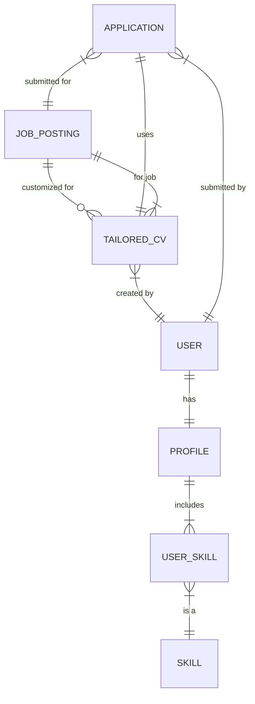
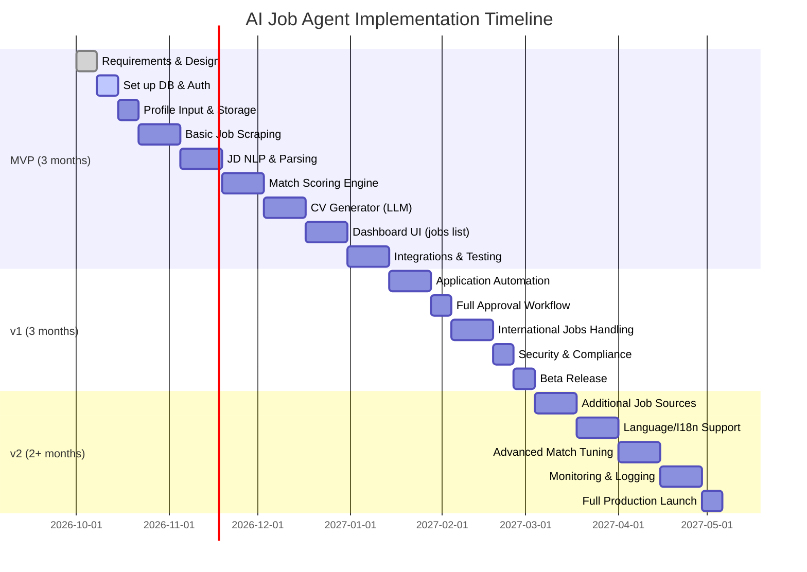

# Executive Summary  
We propose an **AI Job Application Agent** that automates finding, matching, and applying to jobs per the user’s real profile and preferences. It ingests the user’s CV, skills, experience and explicit preferences (roles, salary, and *location/remote* preferences) and then continuously searches job boards and company career pages. Each new job (JD) is parsed by an NLP/LLM module to extract requirements, which are compared against the user’s data via a matching engine. The agent computes multi-dimensional fit scores (skills, experience, role, location, compensation, work‑authorization/visa) and uses these to rank opportunities. For each suitable job, the agent generates an **ATS-friendly, job-specific CV** using an LLM prompt (strictly based on *actual* user experience, never inventing new achievements). These tailored CVs are saved and linked to each job. 

After generating the tailored CV, the agent uses a **browser automation** module (e.g. Playwright) to auto-fill the application form and attach the CV. By default it stops for **user approval** before final submission (with an option to enable fully unattended mode later). The system maintains a **dashboard** showing all discovered jobs with match scores, applications submitted, current status, and allows the user to view/download the exact CV used for any application. It tracks and prevents duplicate applications, logs every step (audit trail), and prompts the user whenever human input is needed (e.g. CAPTCHA, MFA, or missing info). 

Crucially, location and remote preferences are built into matching. We prioritize (in order): (1) **Global remote** jobs (outside India) that explicitly allow remote work, (2) **Remote-from-India** jobs (work-from-home roles open to Indian candidates), (3) **Local remote** (WFH India), (4) **Hybrid** roles in India, and (5) **On-site** roles in India (with configurable city ranking: Vadodara, Ahmedabad, etc). International jobs requiring relocation/visa are flagged for review or filtered based on the user’s willingness. The system never assumes foreign work authorization; if unclear, it asks the user. 

Below we detail the system architecture, data model, component workflows, prompt engineering, security/privacy, and an implementation roadmap (MVP through v2). Design choices are justified and (where applicable) supported by references to state-of-the-art tools and best practices.

## System Architecture  

```mermaid
flowchart LR
    U[(User Profile & Preferences)] -->|inputs| Agent(AI Job Agent)
    subgraph Agent "AI Job Agent"
      JS[Job Search & Aggregation]
      JP[JD Parsing & NLP]
      ME[Matching & Eligibility Engine]
      CV[CV Generator (LLM)]
      AUT[App Automation (Browser)]
    end
    Boards[Job Platforms & Career Pages] 
    DB[(Database)]
    AppsDB[(Applications & Status)]
    Dash[Dashboard/UI]
    
    Agent --> JS
    JS -->|fetch jobs| Boards
    Boards --> JP
    JP --> ME
    ME --> CV
    CV --> DB
    ME --> AUT
    AUT --> DB
    DB --> Dash
    AppsDB --> Dash
    Dash -->|shows status & CVs| U
    U -- "Approve/Submit" --> AUT
```

- **Components**:  
  - **User Interface / Dashboard**: Web UI for user profile input, preferences, reviewing matches, and approving applications.  
  - **Database**: Stores user profiles (CV, skills, preferences), scraped job postings, tailored CVs, application records, and logs.  
  - **Job Search Module**: Periodically queries job sources (via APIs or scraping) and inserts new JDs into the DB.  
  - **JD Parser & NLP**: Processes each JD text with LLM/NLP to extract required skills, roles, locations, visa info, etc.  
  - **Matching Engine**: Computes fit scores by comparing JD requirements vs the user profile. Implements eligibility filters (experience/qualification mismatch, work‑authorization, etc.) and computes sub-scores (skill match, experience level, location/preference match, compensation fit).  
  - **CV Generator**: Uses an LLM with a carefully designed prompt (see below) to produce an **ATS-optimized CV** highlighting the user’s relevant experience for that job. Ensures all content comes from the user’s actual profile.  
  - **Application Automation**: A headless browser tool (e.g. Playwright) that navigates the job application form, fills fields from the user’s data, uploads the tailored CV, and submits (if approved).  
  - **Audit/Logging**: Tracks every decision and action (jobs considered, scores, CVs generated, applications submitted) for full transparency and ability to re-run or review.  

- **Data Flow**:  
  1. **Profile & Preferences**: User provides their CV/details and sets preferences (desired roles, salary, location priorities including remote vs on-site). The preference component stores detailed location rules (see next section).  
  2. **Job Discovery**: The Job Search module queries multiple sources (job boards, career pages) to populate new JDs. Each JD is sent to the JD Parser.  
  3. **JD Understanding**: The JD Parser uses LLM/NLP to extract structured info (skills, responsibilities, location requirements, visa/remote policy).  
  4. **Matching & Scoring**: The Matching Engine filters out ineligible jobs (e.g. requires qualification/experience user lacks, or cannot work authorization) and calculates **multi-dimensional fit scores**. Example breakdown:  
     - *Skill Fit* (e.g. % overlap of required skills vs user skills, or cosine similarity via embeddings).  
     - *Experience Fit* (match in years/seniority).  
     - *Role Fit* (title/industry match).  
     - *Location Fit* (based on the user’s preference ranking for remote vs on-site and city priorities).  
     - *Compensation Fit* (checks if offered salary meets expectations).  
     - *Eligibility* (remote/visa rules: e.g. global remote vs regional remote vs location-bound).  
     Each job’s overall score and sub-scores are stored for display. Jobs failing hard filters (e.g. cannot legally be applied to) are marked ineligible.  
  5. **CV Tailoring**: For each high-scoring eligible job, the CV Generator creates a new resume. This ATS-friendly CV focuses on the job’s keywords, skills and responsibilities, written as bullet points and using simple layouts (no images, minimal styling). The system instructs the LLM to use *only* the user’s known achievements (never adding or exaggerating) and to ask clarifying questions if info is unclear. The tailored CV is saved in the DB and linked to that job.  
  6. **User Approval**: The user reviews proposed applications via the dashboard (viewing the job details, match scores, and tailored CV). They can approve or adjust before final submission. This ensures no unwanted applications and allows manual tweaks. A “preview CV” view lets the user download or edit the CV if needed.  
  7. **Application Submission**: With approval, the Application Automation module opens the job site, logs in (if needed), fills the form fields (name, contact, portfolio links, answers to custom questions, etc.) using stored profile info, attaches the tailored CV, and submits. The agent handles each site’s quirks via scripts. On encountering CAPTCHAs, MFA, or unknown input fields, it pauses and prompts the user.  
  8. **Tracking**: Submission results (success, need for additional steps, etc.) are recorded. The dashboard shows application status (submitted, rejected, interview, etc. if known). Duplicate applications are prevented by checking job IDs against past submissions.  

## Location and Remote-Work Preferences  

The agent treats location/work-mode as a first-class preference factor. The matching logic applies these rules in priority order: 

- **Global Remote (Outside India)** – Highest priority. Any job tagged “Remote” or “Work From Home” with no country restrictions (or explicitly open worldwide) is top preference. Even if the employer is based outside India, if they allow employees to work from anywhere, it is eligible.  
- **Remote-from-India** – Next priority. Remote roles that explicitly allow Indian workers (e.g. “remote (India)”, “open to India”, or remote roles in companies that list India as an option).  
- **WFH India (Local Remote)** – On-site jobs within India that allow full remote.  
- **Hybrid (India)** – Roles that require occasional office presence in India.  
- **On-site (India, by city order)** – Finally, fully on-site roles in India. Cities are ranked per user preference (e.g. Vadodara #1, then Ahmedabad, Gandhinagar, Surat, Pune, Mumbai, Hyderabad, Delhi/NCR, Bengaluru, etc.), but the user can reorder this list in their profile.  

For **international on-site jobs**, the agent checks visa/relocation terms:  
- If **visa sponsorship/relocation assistance** is offered, the job is marked “Eligible with flag” (for user review).  
- If the job requires **existing work authorization** (no sponsorship), it’s marked ineligible and filtered out.  
- If the remote status or visa support is unclear, the agent flags the job and asks the user to confirm applicability before proceeding.  

This ensures truly remote roles (especially those open to India) surface first, and only then local and hybrid roles. In the UI, each job listing shows a clear “Location” badge (e.g. 🏠 Remote, 💼 Hybrid, 📍 CityName) and “Remote: Yes/No (India)” line, so the user understands why and how it matched their preferences.

## Data Model  

A simplified Entity-Relationship model of the key tables is shown below. The database stores user profiles, skills, jobs, tailored CVs, and applications with their status.  



- **USER** (id, name, email, contact, auth_cred, etc.)  
- **PROFILE** (user_id FK, professional summary, total_experience, qualifications, etc.) – detailed user info.  
- **SKILL** (id, name) and **USER_SKILL** (user_id, skill_id) – normalizing user’s skills.  
- **JOB_POSTING** (job_id, source (site), title, company, location, is_remote, salary_range, description, requirements, date_posted, etc.).  
- **TAILORED_CV** (cv_id, user_id, job_id, content or filepath, created_at) – one per job application attempt.  
- **APPLICATION** (app_id, user_id, job_id, cv_id, status, applied_at, response_date, notes) – tracks each submission.  

This schema (implemented in an RDBMS like PostgreSQL) allows history and audit. For text and vector data (e.g. embeddings of job and profile), we may add auxiliary columns or a dedicated vector store.

## AI / LLM Workflow and Prompting  

### JD Understanding and Matching  
- **Embeddings for Similarity**: We use a vector database (e.g. Pinecone or Milvus) to store embeddings of job descriptions and user profiles. On parsing a JD, we compute an embedding (via an LLM or transformer model) and compare to the user’s profile embedding to get a semantic similarity score. For example, Pinecone “searches in parallel” and yields fast similarity retrieval. Alternatively, open-source Milvus can be self-hosted for this purpose.  
- **LLM Extraction**: We also prompt an LLM (like GPT-4 or LLaMA-3) to extract structured info. For example:  
  ```
  "Analyze the following job description and list the required skills, responsibilities, and any location/visa requirements. For example, identify if it's fully remote, location-bound, and if visa sponsorship is mentioned."  
  ```  
  This yields bullet lists of skills and notes on remote/visa, which feed the scoring logic.  

- **Scoring & Ranking**: The agent computes sub-scores (skills match, experience match, role match, location fit, salary fit) for each job. These might be, for instance, percentage overlaps of keywords, years-experience differences, and distance in preference ranking for location. The final **Overall Fit Score** is a weighted sum (weights configurable). Any job failing a hard eligibility filter (e.g. missing qualification, rejected location/visa) is excluded from applications.

### CV Tailoring  
- **Prompt Engineering**: We use an LLM (e.g. GPT-4 or an open Llama model) with a carefully designed prompt. A sample prompt template:  
  ```
  "You are an expert resume writer. Using ONLY the factual information from the user's existing profile below, write a concise, ATS-friendly resume tailored to the given job description. Do NOT invent any new achievements or skills. Emphasize the most relevant experience and keywords for this position. If something is missing, ask clarifying questions instead of guessing."  
  [User Profile Content]  
  [Job Description]  
  ```  
  This instructs the model to focus on relevant keywords (per ATS advice) and to ask questions if needed, preventing hallucinations.  
- **ATS Formatting**: The output CV uses bullet points, simple formatting, common fonts (Arial/Calibri), no images/tables. It highlights action verbs and job keywords, as studies show ATS-scanners rely on matching such keywords. A “master CV” template is maintained internally; the tailored CV is essentially a filtered/sorted subset of bullet points from that, phrased to mirror the JD.  
- **Human-In-The-Loop**: The generated CV is previewed by the user. They can modify or approve it. This prevents any undesired exaggeration and ensures accuracy.

### Job Application Automation  
- **Browser Framework**: We choose a modern browser automation tool. *Playwright* is recommended: it offers a single API to control Chromium, Firefox, and WebKit, and has built-in reliability features. It supports Python and can run headless or with a UI. (Selenium is an alternative; it’s very stable and language-flexible, but Playwright’s modern API and built-in waiting/locator features make it more robust for SPAs.)  
- **Form Filling**: Pre-scripted workflows handle common forms (LinkedIn, company ATS systems, Google Forms, etc.). For each job site, the agent has a script to map user data to form fields. It also handles multi-page flows and uploads the tailored CV PDF.  
- **CAPTCHA & MFA**: If a CAPTCHA or multi-factor authentication appears, the agent pauses. The user receives a dashboard notification and performs the step manually; once done, the agent resumes.  
- **Error Handling**: The agent verifies submission by checking confirmation pages or emails and logs success or failure. Failures (e.g. site layout changes) are alerted to developers for script updates.

### Approval Workflow and Audit  
- By default, **user approval** is required before submission. The dashboard shows each “ready-to-apply” job with buttons [Preview CV] and [Apply]. Only on clicking [Apply] does the automation run. (Optionally, an advanced mode can auto-apply.)  
- Every action and decision is logged. The user can view an audit trail (e.g. “Job found on LinkedIn 10/01, matched at 92%, CV generated 10/02, submitted 10/03”). This meets compliance needs and aids debugging.

## Job-Search Integration  

We integrate multiple job sources to ensure coverage:  

- **Aggregators / APIs**: Use platforms like **Apify** which provide “unofficial” job APIs. For example, Apify’s Indeed Actor lets us fetch JSON results for a given query. The agent can call such APIs (with caching) to pull new listings. (This avoids HTML parsing and handles pagination.)  
- **Job Boards**: For sites without APIs (e.g. LinkedIn, Naukri, Monster, Glassdoor, AngelList, Internshala, etc.), use headless scraping via Playwright. For LinkedIn, login credentials are securely stored (encrypted) and used to navigate the jobs page and scrape listings.  
- **Company Career Pages**: The agent can fetch RSS or HTML from companies of interest (if the user adds specific companies) and parse jobs by scanning for `<li>` or JSON feeds.  
- **Remote-specific sites**: Include remote-work aggregators (WeWorkRemotely, RemoteOK, AngelList) which often have APIs or easily scraped listings, to prioritize remote jobs.  
- **Search & Alerts**: Optionally integrate Google Alerts or Google Custom Search for new postings matching certain keywords or company names.  

Each source’s results are normalized (job title, company, location, description, link) before feeding into the parser. Sources are polled periodically (frequency is configurable).

## Dashboard and User Interface  

The web dashboard lets the user:  
- **View Found Jobs**: A sortable list with columns like Overall Fit, Location, Salary, matched Keywords, and short badges (🏠Remote, 🌏Remote (India), 🏢Hybrid, 📍City). Each job row shows detailed sub-scores on hover or expansion (skills, experience, location fits). Icons or color-coding indicate eligibility.  
- **Filters**: By default, only eligible jobs (per hard filters) are shown. The user can toggle to see ineligible ones (with explanations). They can also filter by fit score thresholds or location type (e.g. show only remote).  
- **CV Preview**: For any job, [Preview Tailored CV] opens the generated resume PDF (with download).  
- **Apply Controls**: Buttons [Apply] (with confirmation dialog) or [Skip]. [Apply] runs the automation after final review. There’s also an [Auto-Apply Mode] toggle to batch-submit.  
- **Application Tracker**: A separate tab shows all applied jobs, application dates, status (submitted, interview, etc.), and a link to the CV used. Duplicate-applications are blocked.  
- **Preferences Page**: The user can reorder location cities and remote settings (e.g. drag-and-drop cities, switch remote preference on/off). They update salary range, desired roles/keywords, etc. These immediately affect matching.  

The dashboard calls a REST API (see next section) to fetch and update data. It also displays logs of any issues (e.g. “LinkedIn required CAPTCHA at 15:02, awaiting user input”).

## API Design  

A RESTful backend serves the agent and UI. Key endpoints include:  

- `POST /api/profile` – upload or update user CV/details and preferences.  
- `GET /api/jobs` – return matched jobs (with filters as query params, e.g. `?status=ready`). Includes match scores and brief details.  
- `GET /api/jobs/{id}` – job detail and user fit breakdown (skills lacking/exceeding, location fit, etc.).  
- `POST /api/jobs/{id}/generate_cv` – triggers (re)generation of the tailored CV for job.  
- `GET /api/cvs/{id}` – retrieve the tailored CV file or data.  
- `POST /api/jobs/{id}/apply` – mark job for application; after user confirmation, the agent submits.  
- `GET /api/applications` – list of user applications and statuses.  
- `GET /api/applications/{id}` – details of an application record (incl. CV used).  
- `GET /api/dashboard` – summary stats (number of jobs found/applied, average fit score, etc.).  

Authentication uses OAuth2 (e.g. Google/Microsoft login) or JWT for the user. All API calls require a valid user token. 

## Technology Stack and Components  

- **Backend**: Python (e.g. Flask/FastAPI) or Node.js for microservices. Contains job search schedulers, LLM integration (via OpenAI API or locally-hosted LLM), and browser automation (via Playwright).  
- **Frontend**: React or Vue.js for dynamic dashboard with charts (job score distribution) and tables.  
- **Database**: PostgreSQL (with [PGVector](https://github.com/pgvector/pgvector)) could handle embeddings simply, or MongoDB for schemaless (with a vector store). Alternatively, use a separate vector DB (Pinecone or Milvus) plus a relational DB for metadata.  
- **Vector Store**: *Comparison:* Pinecone (SaaS, auto-scalable, enterprise compliance) vs Milvus/Weaviate/Qdrant (self-hosted, open-source). We recommend Pinecone for ease of setup and compliance, or Milvus if fully self-hosted (Milvus is proven high-performance).  
- **LLM Models**: We can use OpenAI GPT-4 (or Claude 3) for best understanding/quality, or open models (Meta Llama 3) for cost control. Llama 3’s 70B model “offers similar performance… at a fraction of the cost”. We may use a hybrid: GPT-4 for final CV/pitch generation, and an open model for bulk keyword extraction.  
- **Browser Automation**: *Playwright* (multi-browser, stable API). **Alternate:** Selenium (mature and widely-used). We lean toward Playwright for new projects.  
- **Orchestration/Workers**: Celery or RQ for asynchronous tasks (job searches, CV generation). Alternatively, an orchestration platform like Temporal.io can manage complex multi-step workflows with retries. We prefer Celery (Python) or GitHub Actions for scheduled jobs.  
- **Infrastructure**: Deployed on AWS/GCP/DigitalOcean; Docker containers; Kubernetes (optional) for scaling. CI/CD via GitHub Actions: automated tests (unit and integration), linting, and deployment pipelines.  
- **Security**: Store secrets (API keys, OAuth credentials) in AWS Secrets Manager or Vault. Use HTTPS for all data in transit; encrypt sensitive data at rest (CVs, personal info). Pinecone supports encryption and is GDPR-compliant, helping with vector data security. Ensure compliance with India’s data privacy laws (e.g. Digital Personal Data Protection) and GDPR for global jobs (obtain user consent before processing data).  

## Implementation Roadmap  

We outline a phased implementation:



**Milestones:**  
- **MVP:** Core functionality (profile input, job search from a few boards, basic matching, CV tailoring, manual apply flow, dashboard).  
- **v1:** Full automation, more sources, robust error handling, compliance features (encryption, consent flows).  
- **v2:** Scale up (more sources and user accounts), multi-language UI, analytics/monitoring, and iterative improvements (feedback loops for better matching).

Team assumption: 2-3 developers, 1 QA, over ~6 months to v1, ~9 months to v2. Adjust as needed.

## Prompt Templates & LLM Guidance  

- **Clarifying Questions:** As Gregg Frostrom advises, prompt the LLM to ask questions rather than hallucinate. E.g.:  
  ```
  "Help me tailor my attached resume for the linked position. If any detail is missing or ambiguous, ask me clarifying questions to ensure accuracy."  
  ```  
- **Match Explanation:** For audit/transparency, we may use the LLM to generate human-readable rationales. Example prompt:  
  ```
  "Given the user profile and this job description, explain in a short paragraph why the skill match is high/low, and whether the location/visa fits the user's preferences."  
  ```  
  This can populate a “Reason” field for the user.  
- **CV Styling:** Include instructions like “use first-person bullet points without pronouns, focus on achievements, and format for ATS.” Because research shows ATS parse keywords best in simple formats, the prompt explicitly instructs bullet formatting.  
- **Feedback Loop:** Periodically ask the user: “Were these application results relevant?” to collect training data and refine matching weights or prompt phrasings.

## Evaluation Metrics and Testing  

We define metrics and tests to ensure correctness and performance:

- **Functional Tests:**  
  - *Scraping/Integration:* Ensure each job source API/scraper returns expected data (test against known queries).  
  - *JD Parsing:* Unit tests on the NLP parser (given sample JDs, verify extracted skills match a ground truth list).  
  - *Matching Accuracy:* For a test set of jobs, manually label “good fit” vs “poor fit” and ensure the system’s rank aligns (e.g. top-N precision or recall).  
  - *CV Generation:* Check that the generated CV contains only user facts. We can devise tests where certain facts are omitted and verify the CV doesn’t mention them. Also ensure required keywords appear.  
  - *Automation:* Simulate applying on a variety of forms (dummy sites) and verify fields are filled correctly.  
  - *End-to-End:* Use a test user and run the full flow on a known job to check that the right CV is submitted.  

- **Performance Metrics:**  
  - *Job Coverage:* Number of jobs found per day across sources (aim: >100/day).  
  - *Speed:* Average time to process a job (target <30s per job for parsing and CV generation using LLM).  
  - *Application Throughput:* Number of applications submitted per day.  
  - *Error Rate:* Failures in scraping or application (target <5%).  
  - *User Effort Saved:* Survey metric – time spent by user vs without agent.  

- **Quality Metrics:**  
  - *Match Quality:* Have the user (or domain experts) rate a sample of matched jobs and tailor-MCVs. Use this feedback to adjust scoring weights.  
  - *False Positives:* Instances where agent applied to a clearly bad match (should be minimal).  
  - *Duplicate Prevention:* Verify no job is applied to twice.  

- **Security/Privacy Tests:**  
  - Ensure personal data encryption at rest/in transit.  
  - Test that secret keys (e.g. OpenAI API key) are never exposed in logs or UI.  
  - Verify GDPR compliance: user can delete account/data (“right to be forgotten”) and sees consent prompts.

## Privacy and Security Checklist  

- **Data Encryption:** All sensitive data (CV text, contact info) is encrypted at rest (AES-256) and in transit (HTTPS/TLS). Use secret stores for API keys. Pinecone’s enterprise offering includes encryption and GDPR/SOC2 compliance if used.  
- **Authentication & Access:** Use OAuth2 login (e.g. Google) or secure JWT. Two-factor authentication recommended for the account. RBAC: ensure each user sees only their own data.  
- **Consent & Compliance:** Explicitly inform the user what data is collected and how it’s used (in a privacy policy). Comply with India’s Personal Data Protection Bill (obtain user consent, limit data usage) and GDPR for any EU data.  
- **Audit Logging:** Record all automated actions (scrape time, job parsed, application submitted). Logs must not contain full sensitive data (e.g. only store hashes of CVs, not the full text).  
- **Prompt Injection / LLM Safety:** Sanitize all inputs to the LLM prompt (especially if user can edit the JD or CV inputs) to prevent code injection. Use the LLM in a closed environment. Regularly review LLM outputs for bias or hallucination.  
- **Server Security:** Run all components in a private VPC. Regularly update dependencies. Use containers with least-privilege. Monitor for unusual activity.  

## Technology Comparison Tables  

| **Category**         | **Option**          | **Pros**                                        | **Cons**                                    | **Recommendation**                            |
|----------------------|---------------------|-------------------------------------------------|---------------------------------------------|-----------------------------------------------|
| **LLM Provider**     | OpenAI GPT-4        | High-quality text understanding; long context.  | Expensive; requires API key; data goes offsite.| Use for critical tasks (CV writing, JD parsing) if budget allows. |
|                      | Anthropic Claude 3  | Strong at following instructions; good privacy. | Costly; not as widely available as OpenAI.   | Alternative for variety; similar use-case.    |
|                      | Meta Llama 3 (open)| Completely free to use/self-host; up-to-date.   | Requires large GPU memory (70B model); less polished.| Fine-tune smaller Llama for internal use; consider Llama3.3 (70B) as it rivals larger models. |
|                      | Other open LLMs (Mistral, etc.) | No API costs; can run locally; customizable. | Quality varies; may need fine-tuning.        | Consider as backups or for prototyping.       |
| **Vector Database**  | Pinecone (managed)  | Fully managed, auto-scaling, fast queries. Compliance-ready (SOC2/GDPR). | Usage cost; vendor lock-in.                  | Recommended for ease of use and security.     |
|                      | Milvus (open-source)| High-performance, scalable, used in production. | Requires self-hosting/maintenance.           | Good if self-managed; powerful for large scale. |
|                      | Weaviate (open)     | Schema + text search; GraphQL API.              | Less mature for very large data; ops overhead.| Use if semantic search and filtering needed.  |
|                      | Qdrant (open)       | Easy to self-host; good Python support.         | Smaller community, fewer integrations.        | Fine for moderate use; cost-effective.        |
|                      | PostgreSQL+PGVector| Use existing RDB; moderate embeddings support.   | Not as fast at scale; limited GPU acceleration. | If already using Postgres, simpler small-scale choice. |
| **Orchestration**    | Celery + Redis      | Mature task queue (Python), easy scheduling.    | More boilerplate setup; error handling needed.| Good general choice for Python workers.       |
|                      | Airflow             | Great for complex workflows/monitoring.         | Overkill for simple tasks; heavy UI.          | Use for ETL-like workflows if needed.        |
|                      | Temporal.io         | Strong reliability, stateful workflows.         | Steeper learning curve; less common.          | Consider if resilience is critical.          |
|                      | Kubernetes CronJobs | Native scheduling.                              | Harder to manage dynamic tasks.               | If fully on k8s, useful for polling jobs.    |
| **Browser Automation** | Playwright         | Cross-browser (Chromium/Firefox/WebKit); strong Python SDK. Auto-waits and AI-agent features. | Relatively new (but rapidly stable).         | Preferred for new projects; robust for AI agents. |
|                      | Selenium            | Very mature; wide language support. | Slower; needs WebDriver binaries; may flake.  | Use if already familiar; good backup plan.    |
|                      | Puppeteer (Node)    | Headless Chrome; good for Node.js.              | No official Python; only Chromium.            | Less ideal since Playwright covers more.      |
|                      | Apify Actors        | Ready-made scraping actors (LinkedIn, Indeed).  | Dependent on third-party; cost for heavy use. | Useful for quick integration (e.g. Indeed). |
| **Database**        | PostgreSQL         | Relational, ACID, supports PGVector.           | Not native vector search (needs extension).   | Good all-rounder; use for core data.          |
|                      | MongoDB            | Flexible schema, easy to store JSON docs.       | Joins less efficient; must use external vector store. | If expecting schema changes, or storing JD docs as-is. |

(Selection is based on typical developer/team familiarity, cost, and scale. For example, Pinecone is recommended for vector search as a managed service, whereas Milvus is an open alternative.)

## Evaluation & Testing  

**Test Cases:**  
- **Unit Tests:** For each module (e.g. skill extractor, match scoring).  
- **Integration Tests:** Simulate a full application: given a sample CV and JD, verify the CV generated matches expected keywords and that the application workflow completes (using a dummy site).  
- **Regression Tests:** Ensure changes don’t break existing flows (e.g. adding a new job board should not disable LinkedIn scraping).  
- **Security Tests:** Pen-test the APIs and run static analysis on code. Verify privacy compliance via checklist.  
- **User Acceptance:** Pilot with beta users (including the target Indian user base) to ensure the system meets needs (e.g. the location preference logic should match what they expect).

**Metrics:** As noted above, we’ll track both performance (speed, throughput) and quality (user satisfaction, match precision). We’ll also log LLM costs (token usage) and automation success rates as KPIs.

## Rollout Plan  

- **MVP (private beta)**: Launch to a few pilot users. Limit job sources (e.g. LinkedIn, Naukri, one or two remote boards) to iron out core flows. Collect feedback on match relevance and UI.  
- **v1 (public beta)**: Open up to more users; add more job sites (Indeed via API, Monster, AngelList, etc.), refine matching weights, and implement any needed scalability or security improvements.  
- **v2 (full launch)**: Support multiple user accounts with distinct profiles. Add multilingual support (e.g. English, Hindi) if needed. Enhance the AI (e.g. personalization, learning from user actions). Consider premium features (e.g. direct recruiter outreach) and continuous monitoring/alerting for broken scrapers.

In summary, this agentic application combines proven technologies (LLMs for language tasks, vector databases for similarity, and headless browsers for web automation) into an end-to-end system. By following best practices and our phased plan, we build a robust, secure product that significantly streamlines job hunting. 

**Sources:** Official docs and experts informed our design. For example, Pinecone’s site describes it as “a fully managed vector database built for AI” (ideal for our vector search), and resume best-practice guides note that resumes should be “narrowly focused to the skills, keywords… requested by the employer” (validating our ATS-optimization approach). We also adopt prompt-engineering advice from career coaches who emphasize accuracy and clarifying questions when using LLMs. These and other sources are cited above.