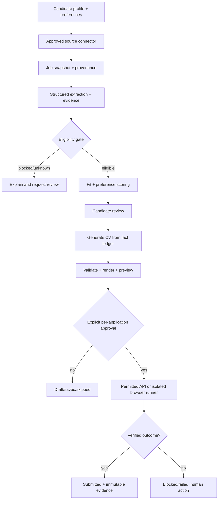

# Production architecture

Status: Phase 5B implementation baseline: discovery pipeline, the live-integration security foundation (egress controls, bound HTTP client, scheduler, health monitoring), and one registered read-only live provider (`ashby_job_board`). It is disabled by default and needs per-deployment enablement, the egress allowlist, and a per-board authorization record. Application submission remains out of scope.

## Decision summary

Use a modular monolith with separate worker processes, not microservices or Kubernetes, for the first production-capable beta:

- Python/FastAPI application for authenticated API and dashboard backend.
- PostgreSQL as the system of record, with optional `pgvector` only after baseline retrieval tests show value.
- S3-compatible object storage for encrypted CV and evidence artifacts.
- A PostgreSQL-backed durable task table with leases, idempotency keys, retries, and dead-letter states; add Redis/Valkey only if measured queue latency requires it.
- Dedicated worker process for ingestion, parsing, matching, and document generation.
- Isolated Playwright runner for explicitly approved, permitted application surfaces.
- Managed secret/KMS service, centralized structured logs, metrics, and alerting.

This shape keeps transaction boundaries and operational reasoning simple. It can split the browser runner or model gateway later without changing domain data.

## Trust boundaries

1. Candidate browser to API: authenticated, CSRF-protected web requests; no model or worker trust is inherited from the browser.
2. API/worker to database/object storage: private network, service identity, least-privilege role.
3. Worker to model provider: outbound allowlist, minimized and redacted payload, provider/data-region configuration, request budget.
4. Worker to job source: deployment and connector host allowlists, SSRF/DNS-rebinding-safe pinned connections, redirect re-validation, time/size limits, normal rate limits, source policy check, no bypass (`backend/app/services/sources/egress.py`).
5. Browser runner to external application: one approved destination, isolated context, no arbitrary model-controlled navigation.
6. Untrusted source text to model: data-only boundary; never treated as instructions or tool permissions.

## Domain modules

- Identity and candidate profile: authentication, profile facts, provenance, consent, preferences.
- Source connectors: provider registry, fail-closed source policy, fetch/validate/normalize/dedup/snapshot pipeline, provenance, terms version, rate limits, circuit breaker, kill switch. Implemented in `backend/app/services/sources/`; see `docs/source-connectors.md`.
- Job catalog: canonical job identity, raw snapshots, deduplication, lifecycle.
- Job intelligence: schema-constrained extraction, evidence, confidence, parser version.
- Matching: eligibility policy, deterministic scores, preference weights, explanation.
- CV: fact selection, draft generation, validation, rendering, immutable versions.
- Application: review package, approval token, form schema, browser/API adapter, submission verification.
- Audit/operations: append-only events, task state, costs, incidents, connector health.

## Main workflow

## State and reliability rules

Every long-running action is a durable task with a unique idempotency key. Tasks use a lease and heartbeat; a crashed worker can be reclaimed after expiry. Retries are bounded and classified:

- Safe retry: GET/read, parsing, rendering, status polling.
- Conditional retry: rate-limit/network failure with source-approved backoff.
- No automatic retry: submission, unknown form, CAPTCHA/MFA, authorization failure, policy violation.

All transitions are append-only events. A state cannot jump from `eligible` to `submitted` without a CV version, approval record, target snapshot, and submission verification record.

## AI architecture

The model gateway is provider-agnostic and exposes a narrow interface:

1. Input assembler selects only required fields and labels source text as untrusted data.
2. Structured output schema rejects malformed or extra fields.
3. Validator checks evidence spans, allowed enums, dates, numeric ranges, and candidate-fact references.
4. Policy engine decides what the model is allowed to influence.
5. Model/version/prompt/template, token/cost metadata, and input/output hashes are recorded.

Models may extract, summarize, classify, paraphrase, and propose. They may not approve eligibility, invent facts, select tools, navigate arbitrary domains, answer unknown employer questions, or submit an application.

## Deployment topology

For the first deployment:

- Managed PostgreSQL in a private network.
- API container behind TLS termination and a web application firewall/rate limiter.
- Worker container with no inbound public access.
- Browser runner in a more restricted network namespace with per-job ephemeral browser context.
- Private object bucket with KMS/envelope encryption and signed, short-lived download URLs.
- Secret manager/KMS; no credentials in environment files committed to the repository.
- CI pipeline runs linting, type checks, migrations in an ephemeral database, unit/integration tests, and sanitized browser tests.

Backups are encrypted and tested for restore. Production data and test data are separate. A staging environment uses provider sandboxes and dummy ATS sites only.

## API boundaries

The future API should expose domain operations rather than model/tool control:

- `GET/PUT /profile` and `GET/PUT /preferences`
- `GET /jobs`, `GET /jobs/{id}`, `GET /jobs/{id}/match`
- `POST /jobs/{id}/cv-drafts`, `GET /cv-versions/{id}`
- `POST /cv-versions/{id}/approve`, `POST /cv-versions/{id}/reject`
- `POST /applications/{id}/review`, `POST /applications/{id}/approve`
- `POST /applications/{id}/start`, `POST /applications/{id}/pause`, `GET /applications/{id}/events`
- `POST /data-export`, `POST /data-deletion`

No endpoint accepts arbitrary URLs, arbitrary browser scripts, arbitrary model prompts, or a “submit all” command.

## Architecture acceptance criteria

- A threat model identifies trust boundaries, assets, abuse cases, and controls before implementation.
- A replay from stored snapshots reproduces a match and identifies the exact CV/application inputs.
- A worker crash does not duplicate a submission or lose the task state.
- A source can be disabled without a deployment.
- A candidate can inspect and revoke a pending approval before the runner starts.
- Logs/metrics/traces contain correlation IDs but no raw candidate secrets or CV content.
